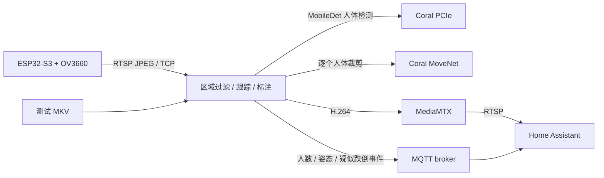

# ESP32-S3 室内区域监控 + Coral + Home Assistant

ESP32-S3 N16R8 + OV3660 负责采集 JPEG，并输出 RTSP/TCP。`pn41` 用 PCIe Coral 检测人体，MoveNet 在第二颗 Coral 上对每个人估计 17 个关节点（也可显式选 CPU），输出带框、人数、姿态的 H.264 RTSP 视频。MQTT Discovery 自动创建 HA 人数、各姿态数量、有人、疑似跌倒和事件实体。

实物摄像头已烧录、配网并接入 pn41 和 HA，也可继续用本地视频测试服务端。实际接入 HA 的操作见 [部署与 HA](docs/deployment.md)，接线与烧录见 [硬件说明](docs/hardware.md)，测试记录见 [验证记录](docs/validation.md)。

补充的婴儿摔倒合集已截取前 90 秒并转换/回放：详见 [摔倒视频测试](docs/fall-video-evaluation.md)。该样本暴露了明显漏报，现有跌倒功能仍需改进，不能视为已通过真实婴儿摔倒验证。

2026-10-31 补充了两个完整视频上的 [Coral 姿态算法对比报告](docs/pose-algorithm-comparison.md)，包含 MoveNet、多人 PoseNet、不同检测器及组合方案的实测、逐帧核对和标注视频；后按用户选择上线 MobileDet + Thunder。

第二轮完成了 [YOLO Pose / Coral 对比](docs/yolo-pose-comparison.md)：包含 YOLOv8n、YOLO11n、YOLO26n、编译优化、量化前后核对、20 次全片回放及同步视频 Review。YOLO 提供更快的单 TPU 备选，当前姿态/跌倒规则仍有明显漏报；没有自动切换生产模型。

第三轮完成了 [连续视频时序算法验证](docs/temporal-algorithm-comparison.md)：使用公开预训练 TSSTG、TCN、LSTM 和 MoViNet，对完整视频、低帧率及 pn41 CPU 开销进行对照。TCN/LSTM 计算开销较低，但直接使用成人数据权重仍有漏报与误报；没有替换线上 Thunder 或向 HA 发布测试事件。[同步视频评审页](artifacts/temporal-comparison/review/index.html) 可查看具体告警时刻。

HA 已接入标注摄像头与 8 个 MQTT 实体，并在侧边栏新增“室内监控”仪表盘（`/indoor-monitor/live`）。当前输入为 `rtsp://192.168.50.39:8554/camera`，按用户选择监控全画面。实物采集约 1–3 fps，仍有无线停顿；服务器按 6 fps 编码，会重复最近画面，不代表 6 次新采集/推理。候选事件链路已用明确标记的模拟事件验证；自动通知尚未启用。



## 快速回放

建议在 Linux x86_64 上运行推理。CPU 测试可使用 Python3.11 + TFLite2.14；Coral 使用经过实测的 Python3.9 + TFLite2.5，不能直接升级运行库。Mac 可运行规则测试、生成报告和编译固件；Mac 上需要自行安装兼容的 TensorFlow 才能进行 TFLite 推理。

```bash
python3.11 -m venv .venv
source .venv/bin/activate
pip install '.[cpu,test]'
python scripts/download_models.py

# CPU 功能验证（不需要 Coral）
indoorcam --source '/absolute/path/test.mkv' --backend cpu

# pn41 上的真实 Coral：使用下文 Compose 的兼容运行环境，
# 或 Python3.9 + Coral 官方 tflite-runtime 2.5.0.post1。
indoorcam --source '/absolute/path/test.mkv' --backend coral
python scripts/report.py
```

Coral 模式要求宿主机装好 `gasket/apex` 驱动与 `libedgetpu.so.1`，且进程可读写 `/dev/apex_0`。Coral 出错会直接失败，避免误以为正在使用 TPU。默认模型以 SHA256 校验，模型来自 Google Coral test_data；模型许可见该仓库，不随本项目重新授权。

输出：

- `artifacts/annotated.mp4`：标注视频，回放按媒体时间抽帧到 8 fps，保持原始时长，无音频。
- `artifacts/detections.jsonl`：逐帧人数、17 点骨架、框、轨迹 ID、ROI 与事件。
- `artifacts/detections.jsonl.summary.json`：平均/p95 耗时和事件数量。
- `artifacts/contact-sheet.jpg`：运行 `report.py` 后生成的抽帧检查图。

离线回放与实时运行使用同一条检测和规则链路。离线模式使用媒体时间；实时模式使用单调时钟，避免系统对时导致误判。`--realtime --loop` 可模拟摄像头，循环时清空轨迹，防止片尾与片头拼接产生跌倒事件。真实告警测试使用独立 `camera_id` 和 MQTT topic，避免把测试通知发给家人。

## 指定监控区域

复制 `config/example.yaml` 到 `config/local.yaml`。`roi` 是输出图像中的归一化多边形，坐标从左上角 `[0,0]` 到右下角 `[1,1]`：

```yaml
roi: [[0.12,0.4], [0.88,0.4], [0.95,0.96], [0.08,0.96]]
roi_anchor: bottom_center
```

默认按人体框底边中点是否位于 ROI 内计数和告警，适合地面区域。躺卧/沙发区域可改 `center`；遮挡和人体框抖动会影响边界判断，ROI 边缘应留余量。ROI 外的人以灰框显示，不计入人数和告警。图像按比例缩放并补黑边，ROI 坐标包含黑边。`roi: []` 监控全画面；当前用户选择先监控全画面。摄像头固定并摆正后再校准机位、人数和姿态。

姿态输出为 `standing / sitting / lying / unknown`。关节点不可见、蹲跪、弯腰或遮挡时允许 `unknown`，不强行归入三种姿态。人数独立于姿态统计，`count` 等于四种姿态数量之和，只统计本帧实际检测到的人，不把消失的轨迹算进去。

## 疑似跌倒规则与限制

每条轨迹保留短时历史。规则要求近期出现站/坐、髋部快速向画面下方移动、转为躺姿，并持续达到 `fall_hold`，才发布 `fall_candidate`。默认窗口 1.2 秒，髋部下降超过之前躯干长度的 0.25 倍，持续躺卧 1.5 秒，同轨迹冷却 30 秒，二进制状态显示 10 秒。断流、循环和轨迹间隔会清空或中止判断。

这是可调的几何时序规则，没有经过跌倒数据集训练与临床验证。弯腰、跪地、坐下、俯身照顾孩子、镜头透视和跟踪 ID 切换可能误报；远处小孩、遮挡、朝向镜头的倒地、检测漏帧可能漏报。候选事件应由人查看视频确认，不能作为唯一的安全保障。测试片是儿童日常活动，不能据此证明跌倒召回率。

`fall_hold`、`fall_drop`、`fall_window` 和关键点阈值在实际机位上用“正常坐下/躺下/弯腰”和安全模拟倒地片段校准。固定镜头、全身可见、侧面或斜侧面视角比顶视角更适合这套规则。超过 `max_people` 时输出 `truncated: true`，计数可能被截断。

## 开发与检查

```bash
pip install '.[test]'
pytest -q

# firmware 测试需要 C++ 编译器；硬件未连接也可编译
pip install platformio
pio run -d firmware -e esp32s3_uart
pio run -d firmware -e compile_check
```

主要代码：`inference.py` 负责模型；`analytics.py` 负责区域、跟踪和时序规则；`video.py` 负责最新帧读取、编码、状态 API；`mqtt.py` 负责 HA 自动发现。测试覆盖姿态几何、跌倒时序/冷却、缓慢躺下、跟踪中断、多人 ROI、断流状态和固件的真实 RTP/JPEG 分包代码。

默认 `detector_model: mobiledet`，可改 `mobilenet` 对照旧模型。`detector_tiles: 2` 在全图之外增加 2×2 个重叠检测裁剪并做 NMS，改善远处小孩漏检；改为 1 可降低负载，改为 3 增强小目标但增加延迟。`pose_backend: auto` 跟随 `backend`；双 TPU 的 pn41 使用 `pose_device: pci:1`，单 TPU 可设为 `pci:0` 共享，但需重新测帧率。

默认对较弱的人体框增加肩部/关键点验证，并过滤高度小于画面 6% 的目标，减少椅子、毯子和墙上图案误检。这也会漏掉严重遮挡或很小的真人，可通过 `verify_person_pose`、`min_person_height` 做现场对照。当前 pn41 使用实物摄像头，直播输出为 6 fps；离线预览为 8 fps。完整结果与剩余限制见验证记录。
